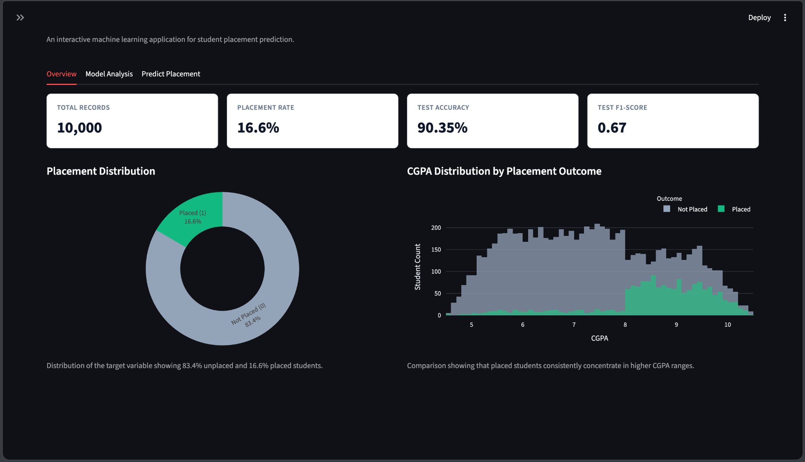
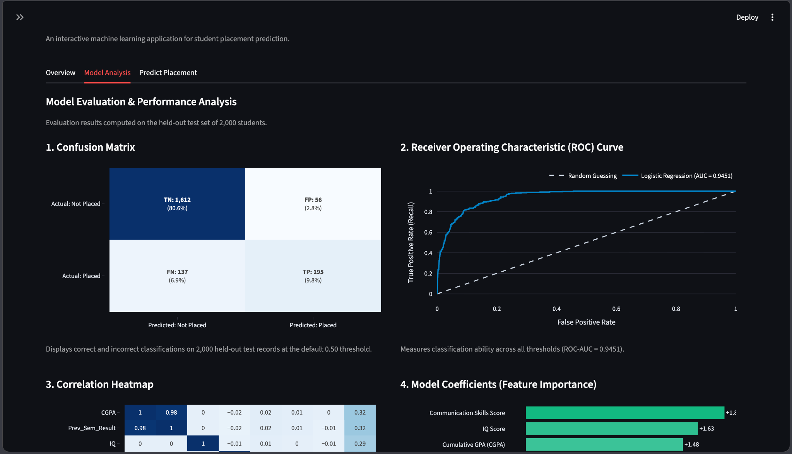
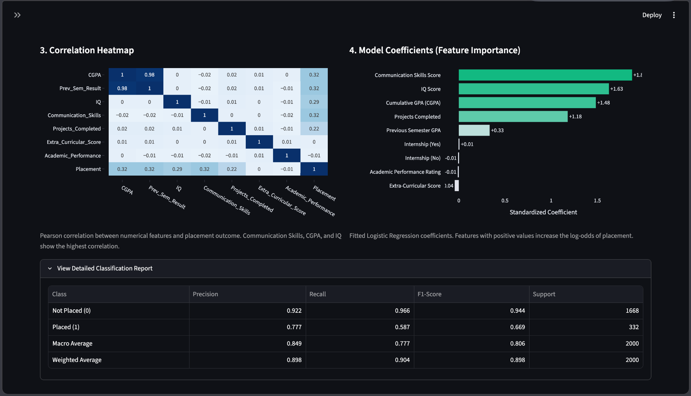
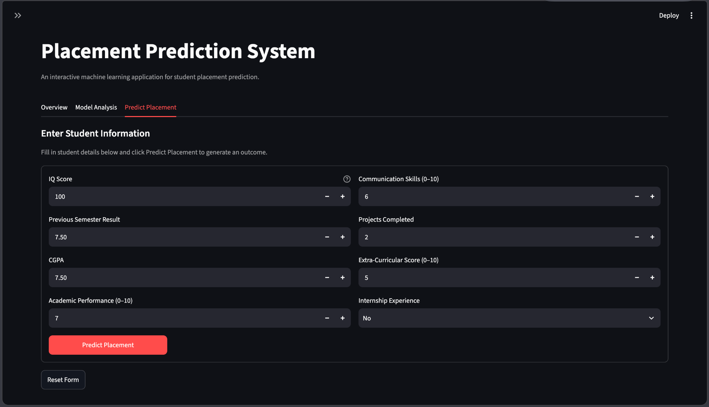
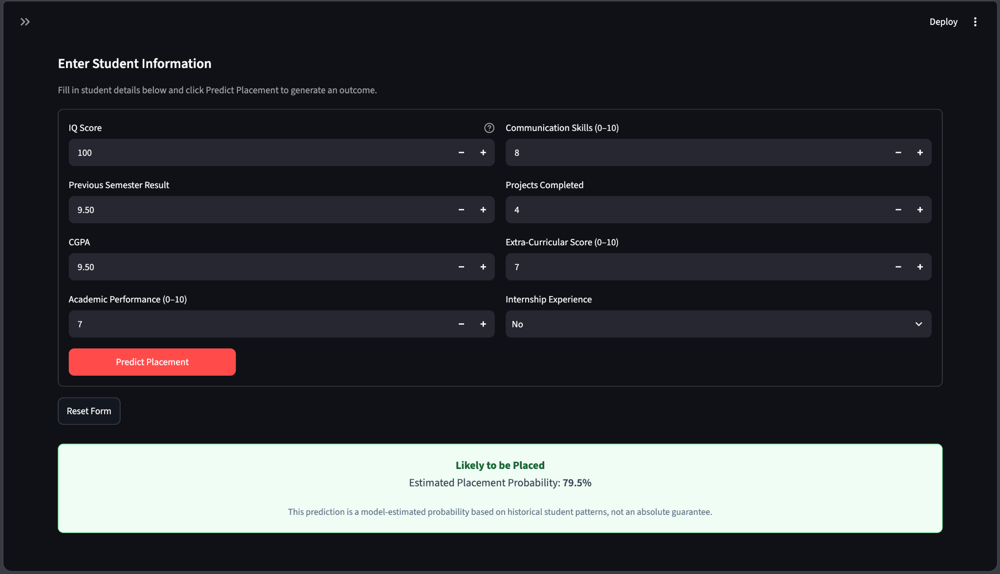

# Placement Prediction System

An interactive machine-learning dashboard that explores student placement data and estimates placement probability using **Logistic Regression**, **scikit-learn**, **Pandas**, **Plotly**, and **Streamlit**.

The application is organized into three sections: **Overview**, **Model Analysis**, and **Predict Placement**.

> **Project context:** This is an educational demonstration of a binary classification workflow. Predictions are estimates from the available dataset, not guarantees about an individual student's placement outcome.

## Frontend Preview

The following screenshots show the Streamlit interface and its main user flows.

### Overview dashboard



### Model evaluation



### Feature and correlation analysis



### Placement prediction form



### Prediction result



## Contents

- [Overview](#overview)
- [Features](#features)
- [Model and evaluation](#model-and-evaluation)
- [Technology stack](#technology-stack)
- [Run locally](#run-locally)
- [Project files](#project-files)
- [Limitations](#limitations)
- [Attribution](#attribution)

## Overview

The model treats placement as a binary classification task:

- `0` — Not Placed
- `1` — Placed

The dashboard summarizes the dataset, presents evaluation results, and lets a user enter student attributes to receive a model-estimated placement probability.

## Features

### 1. Overview

- Dataset record count and placement rate
- Test accuracy and F1-score summary cards
- Placement-outcome distribution chart
- CGPA distribution compared by placement outcome

### 2. Model Analysis

- Confusion matrix
- Receiver Operating Characteristic (ROC) curve and ROC-AUC
- Correlation heatmap
- Logistic Regression coefficient chart
- Detailed classification report

### 3. Predict Placement

The prediction form accepts the following attributes:

- IQ score
- Previous-semester result
- CGPA
- Academic performance rating
- Communication skills score
- Projects completed
- Extra-curricular score
- Internship experience

After submission, the app displays a predicted placement outcome and estimated probability. This is a model output, not a promise of employment.

## Model and evaluation

The current dashboard reports the following results for a held-out test set of 2,000 records:

| Measure | Reported result |
|---|---:|
| Dataset records | 10,000 |
| Placement rate | 16.6% |
| Test accuracy | 90.35% |
| Test F1-score | 0.669 |
| ROC-AUC | 0.9451 |

The displayed confusion matrix at the default threshold of `0.50` is:

|  | Predicted: Not Placed | Predicted: Placed |
|---|---:|---:|
| **Actual: Not Placed** | 1,612 (TN) | 56 (FP) |
| **Actual: Placed** | 137 (FN) | 195 (TP) |

Accuracy alone can be misleading when classes are imbalanced. The confusion matrix, F1-score, recall, precision, and ROC-AUC provide additional context about model performance.

**Reproducibility note:** These values are the results currently shown in the supplied dashboard screenshots. Re-run the training/evaluation workflow before treating them as independently verified results or comparing them with another model.

## Technology stack

- **Python** — application and model workflow
- **Streamlit** — interactive web interface
- **Pandas / NumPy** — data handling
- **scikit-learn** — preprocessing and Logistic Regression evaluation
- **Plotly** — interactive charts
- **Joblib / pickle artifacts** — loading saved model-related objects, if used by the current implementation

## Run locally

### Prerequisites

- Python 3.9 or later
- Git (if cloning a repository)

### 1. Get the project

If you have cloned your own repository, move into its project directory:

```bash
cd path/to/placement-prediction-project
```

### 2. Create and activate a virtual environment

**macOS / Linux**

```bash
python3 -m venv .venv
source .venv/bin/activate
```

**Windows PowerShell**

```powershell
python -m venv .venv
.venv\Scripts\Activate.ps1
```

### 3. Install dependencies

```bash
pip install -r requirements.txt
```

### 4. Start the application

```bash
streamlit run app.py
```

If the default port is unavailable, specify another port:

```bash
streamlit run app.py --server.port 8501 --server.headless true
```

Open the local URL printed by Streamlit, commonly `http://localhost:8501`.

## Project files

The repository may include files such as the following; exact contents depend on the current checkout.

| File | Purpose |
|---|---|
| `app.py` | Streamlit application interface |
| `ml_engine.py` | Model and prediction helper logic, if present |
| `placement.csv` | Dataset used by the project |
| `placement_model.pkl` | Saved model artifact, if present |
| `scaler.pkl` | Saved feature scaler, if present |
| `features.pkl` | Saved feature metadata, if present |
| `threshold.pkl` | Saved classification threshold, if present |
| `placement.ipynb` | Exploratory analysis or training notebook, if present |
| `requirements.txt` | Python dependencies |
| `docs/screenshots/` | README frontend screenshots |

Keep the model artifacts and preprocessing steps consistent with one another. If the model is retrained or the feature order changes, regenerate and validate the related artifacts together.

## Limitations

- The dataset should be treated as an educational benchmark unless its real-world provenance and collection process are independently documented.
- Model performance on this dataset does not establish performance on students from other institutions, cohorts, or recruitment processes.
- Associations learned by Logistic Regression do not prove that a feature causes placement.
- The probability shown by the app is model-estimated and may not be calibrated for real-world use.
- The system should not be used as the sole basis for hiring, placement eligibility, or denying a student access to opportunities.

## Attribution

This repository is an adaptation and extension of an existing student placement prediction project. Please retain the original project's license and any attribution required by its terms. Do not assume that the absence of inherited Git commits removes those obligations.

Before redistributing the project, check the upstream repository's license and include the required license/notice text. If no license is provided, do not assume that the source code is automatically licensed for redistribution.

---

Built as a student machine-learning project for exploration, demonstration, and learning.
